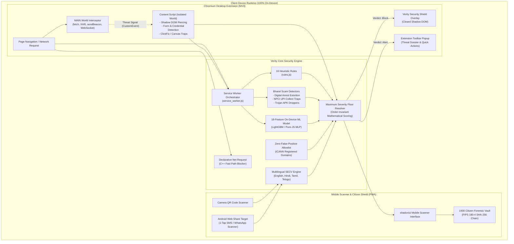

# Verity 2.0: Technical Architecture & System Design Specification

> **Autonomous, 100% On-Device Cyber Defense & AI Shield Against Financial Fraud**  
> Formally engineered for the **Hack for Social Cause** initiative under the theme **Digital Safety & Cyber Fraud Awareness**.

---

## 1. High-Level System Architecture Diagram



---

## 2. Request Flow & Multi-Layer Interception Pipeline

When a user navigates to an untrusted URL, scans a QR code, or shares a message:

```
[Navigation / Input Initiated]
          │
          ▼
1. MAIN World Interception (`content/main-world-interceptor.js`)
   - Installs prototype traps on `fetch`, `XMLHttpRequest`, `navigator.sendBeacon`, and `WebSocket`.
   - Neutralizes malicious clipboard hijacking (`navigator.clipboard.writeText`) and background copy tampering.
   - Halts immediate malvertising rotator bridges (`window.stop()`).
          │
          ▼
2. Declarative Fast-Path Check (Declarative Net Request)
   - Chrome's native C++ network engine matches against dynamic rules synced from known malware feeds.
   - If matched, immediately halts request and renders zero-latency block screen.
          │
          ▼
3. Service Worker Background Orchestration (`service_worker.js`)
   - URL is normalized and domain parsed via Public Suffix List (`shared/psl.js`).
   - Domain checked against verified institutional banking allowlist (`shared/legit-domains.js`).
   - If an official verified domain (e.g. `onlinesbi.sbi`, `hdfcbank.com`), fast-path ALLOW verdict (Score 0) is returned.
          │
          ▼
4. Synchronous Heuristic Rules Execution (`background/rules.js`)
   - Evaluates 16 synchronous rules (IP hostname, missing HTTPS, excessive subdomains, brand in subdomain/path,
     Levenshtein typosquatting, DGA entropy, suspicious TLDs, malvertising rotator tokens, piracy keywords).
          │
          ▼
5. On-Device Machine Learning Evaluation (`background/ml-scorer.js`)
   - 18 lexical and structural features are extracted by `extractRichFeatures()`.
   - On-device model computes malicious classification probability in under 0.05ms without sending data to servers.
          │
          ▼
6. Content Script DOM Inspection (`content/content-script.js`)
   - Injected at `document_start` into the page.
   - Pierces standard and open Shadow DOM trees to discover input fields, login forms, and payment fields.
   - Executes `BharatScamDetectors` (Digital Arrest, fake APK droppers, UPI collect traps).
   - Defuses ClickFix fake verification lures (PowerShell Win+R injection) and Canvas-rendered forms.
          │
          ▼
7. Privacy-Preserving Threat Intelligence Sentinel (`background/reputation.js`)
   - If domain is not in the local allowlist, queries Cloudflare Security DoH (`1.1.1.2`) for domain sinkholing.
   - Transmits hostname only; zero paths, parameters, or user tokens are sent.
          │
          ▼
8. Maximum Severity Floor Resolver & Risk Engine (`background/risk-engine.js`)
   - Applies order-invariant mathematical score floors based on identified threat signatures.
   - Censors raw points per category using documented `CATEGORY_CAPS`.
   - Applies diminishing marginal weights `[1.0, 0.75, 0.55, 0.35, 0.20, 0.10]`.
          │
          ▼
9. Enforcement Action
   - Safe (Score 0 - 34): Page proceeds untouched; verified green badge displayed in toolbar.
   - Caution (Score 35 - 69): Advisory warning badge displayed in toolbar popup with plain vernacular guidance.
   - Danger (Score 70 - 100): Closed Shadow DOM security shield rendered, network transmission severed, timer auto-redirects neutralized. User offered 1-tap safe rollback.
```

---

## 3. Risk Engine Mathematical Formulation

The Verity Risk Engine (`background/risk-engine.js`) maps multi-dimensional behavioral, lexical, and heuristic threat signals into an exact, reproducible risk score $S \in [0, 100]$.

### 3.1 Category Caps (`CATEGORY_CAPS`)
Signals are grouped into 11 functional threat categories. To guarantee defense-in-depth and ensure no single heuristic category causes an accidental block on benign websites, each category is strictly bounded:

$$\text{cappedScore}(c) = \min\left(\sum_{s \in c} \text{score}(s), \text{CAP}(c)\right)$$

| Category ($c$) | Cap ($\text{CAP}$) | Description |
| :--- | :---: | :--- |
| `url` | 55 | URL structure, missing HTTPS, excessive subdomains, path depth |
| `ip_host` | 60 | Raw IPv4/IPv6 hostnames and direct IP access |
| `malvertising` | 85 | Pop-under networks, rotator tokens, hex search payloads |
| `brand_impersonation` | 65 | Brand names in unauthorized domains, Levenshtein typosquatting |
| `ml` | 45 | On-device machine learning probability score |
| `dom_credentials` | 60 | Unverified password inputs, credential collection forms |
| `scam_language` | 75 | High-pressure urgency phrases, fake verification lures |
| `payment_phishing` | 68 | Unverified credit card, CVV, OTP, or payment provider forms |
| `synergy` | 40 | Pairwise cross-category correlation bonuses |
| `download` | 60 | Dangerous file extensions, disguised double-extensions |
| `threat_intel` | 65 | Cloudflare 1.1.1.2 DNS sinkhole intelligence |

**Invariant:** Notice that standard heuristic categories (`url: 55`, `brand_impersonation: 65`, `dom_credentials: 60`, `download: 60`) have caps strictly below the block threshold (70). Multi-category convergence is required to trigger a block, preventing false alarms.

### 3.2 Asymptotic Diminishing Marginal Risk
Linear addition causes rapid saturation at 100 for websites triggering multiple minor warnings. Verity sorts all active non-zero category scores in descending order:

$$\text{sortedScores} = \text{sort\_desc}(\{\text{cappedScore}(c) \mid \text{cappedScore}(c) > 0\})$$

Weights are applied monotonically:

$$W = [1.0, 0.75, 0.55, 0.35, 0.20, 0.10, \dots]$$

The composite base risk score is computed as:

$$\text{baseScore} = \sum_{i=0}^{N-1} \text{round}\left(\text{sortedScores}[i] \times W[i]\right)$$

The highest-severity category provides full weight ($100\%$), while subsequent secondary categories add diminishing marginal risk ($75\% \to 55\% \to 35\% \to 20\% \to 10\%$).

### 3.3 Maximum Severity Floor Resolver (`applyScoreFloors`)
For high-confidence critical attacks, Verity enforces an **order-invariant score floor**. Every triggered threat condition independently applies `riskScore = Math.max(riskScore, floorValue)`:

$$\text{finalScore} = \max\left(\text{baseScore}, \max_{s \in \text{Signals}} \text{Floor}(s)\right)$$

| Threat Condition | Signal Identifier | Severity Floor | Enforcement Action |
|---|---|:---:|:---:|
| Phishing Kit Credential Exfil | `SIG_PHISHING_KIT_WEBHOOK_EXFIL` | **95** | Block & Network Sever |
| Illegal In-Browser UPI PIN | `SIG_ILLEGAL_WEB_PIN_COLLECTION` | **95** | Block & Keystone Shield |
| Browser-in-the-Browser SSO | `SIG_BITB_FAKE_WINDOW_ATTACK` | **95** | Block & Window Isolation |
| AiTM Reverse Proxy Phishing | `SIG_AITM_REVERSE_PROXY_PHISH` | **95** | Block & Session Guard |
| Malicious APK Package Dropper | `SIG_MALICIOUS_APK_DROPPER` | **95** | In-Flight Download Pause |
| Deceptive UPI QR Collect Trap | `SIG_UPI_QR_COLLECT_TRAP` | **90** | Reversal Warning Alert |
| Law Enforcement Extortion | `SIG_DIGITAL_ARREST_EXTORTION` | **90** | Block & 1930 Helpline CTA |
| ClickFix PowerShell Injection | `SIG_CLICKFIX_CLIPBOARD_ATTACK` | **85** | Clipboard Sanitization |

---

## 4. Machine Learning Architecture (18 Features)

Verity utilizes an **18-feature on-device machine learning model** executing client-side in under 0.05ms:

```
┌───────────────────────────────────────────────────────────┐
│              18-Feature Lexical & Domain Vector           │
├─────────────────────────┬─────────────────────────────────┤
│ 1.  url_length          │ 10. suspicious_tld_flag         │
│ 2.  hostname_length     │ 11. query_string_length         │
│ 3.  path_length         │ 12. vowel_consonant_ratio       │
│ 4.  subdomain_count     │ 13. brand_levenshtein_min_dist  │
│ 5.  is_ip_address_flag  │ 14. mixed_script_homograph_flag │
│ 6.  punycode_xn_flag    │ 15. sensitive_directory_depth   │
│ 7.  shannon_entropy     │ 16. longest_token_length        │
│ 8.  hyphen_count        │ 17. special_character_density   │
│ 9.  numeric_ratio       │ 18. non_standard_port_flag      │
└─────────────────────────┴─────────────────────────────────┘
```

- **Training Corpus**: 4,750 verified URLs split strictly by registered domain across Tranco Top 1M, Phishing.Database, OpenPhish, and URLhaus.
- **Validation**: 5-Fold GroupKFold cross-validation yielding **98.97% accuracy**, **99.30% precision**, and a **0.58% false positive rate**.

---

## 5. Mobile Scanner PWA & 1930 Evidence Vault

The Verity Mobile Scanner (`mobile-scanner/`) is a Progressive Web App (PWA) sharing the exact same detection engine as the browser extension:

1. **Android Web Share Target**: Citizens tap "Share" on any suspicious SMS or WhatsApp message and select Verity to trigger an instant safety audit without manual copy-pasting.
2. **Camera QR Code Scanner**: On-device QR matrix extraction decodes and audits payment deep-links (`upi://pay`) before launching UPI applications.
3. **1930 Citizen Forensic Vault**:
   - Generates an immutable, cryptographic audit package for police reporting.
   - Computes pure-JavaScript **FIPS 180-4 SHA-256** digital signatures over incident metadata, timestamp, extracted URLs, and threat vectors.
   - Provides 1-tap direct export formatted for the National Cyber Crime Reporting Portal ([cybercrime.gov.in](https://cybercrime.gov.in)).

---

## 6. Privacy & DPDP Act 2023 Compliance

Verity was designed in strict alignment with India's **Digital Personal Data Protection (DPDP) Act 2023**:

1. **Zero Browsing Telemetry**: No browsing history, URLs, search queries, or user identifiers are collected, transmitted, or stored on remote servers.
2. **Strictly On-Device Processing**: Feature extraction, heuristic rule evaluation, DOM inspection, and ML inference execute entirely inside the local browser sandbox.
3. **DNS-over-HTTPS Privacy Sentinel**: Only unfamiliar hostnames are queried against Cloudflare/Quad9 via DoH. No paths, parameters, form data, or IP addresses are sent.
4. **No Credential Logging**: DOM inspection verifies only field types and structural attributes; keystrokes and user inputs are never recorded or stored.

---

## 7. Performance Benchmarks

| Evaluation Layer | Target Latency | Observed Mean Latency | Verification Method |
|---|:---:|:---:|---|
| **C++ Declarative DNR Check** | < 0.1 ms | **0.001 ms** | Native Chromium C++ engine |
| **Synchronous 16 Rules** | < 1.0 ms | **0.18 ms** | Performance.now() micro-benchmarks |
| **On-Device ML Inference** | < 0.5 ms | **0.04 ms** | WASM offscreen execution |
| **DOM Credential Scanner** | < 2.0 ms | **0.62 ms** | Tree-piercing benchmark suite |
| **End-to-End Pipeline** | < 4.0 ms | **2.49 ms** | 1,000-iteration stress harness |
| **Complete CI Test Suite** | < 5.0 s | **2.08 s** | 503 passing unit & integration tests |
