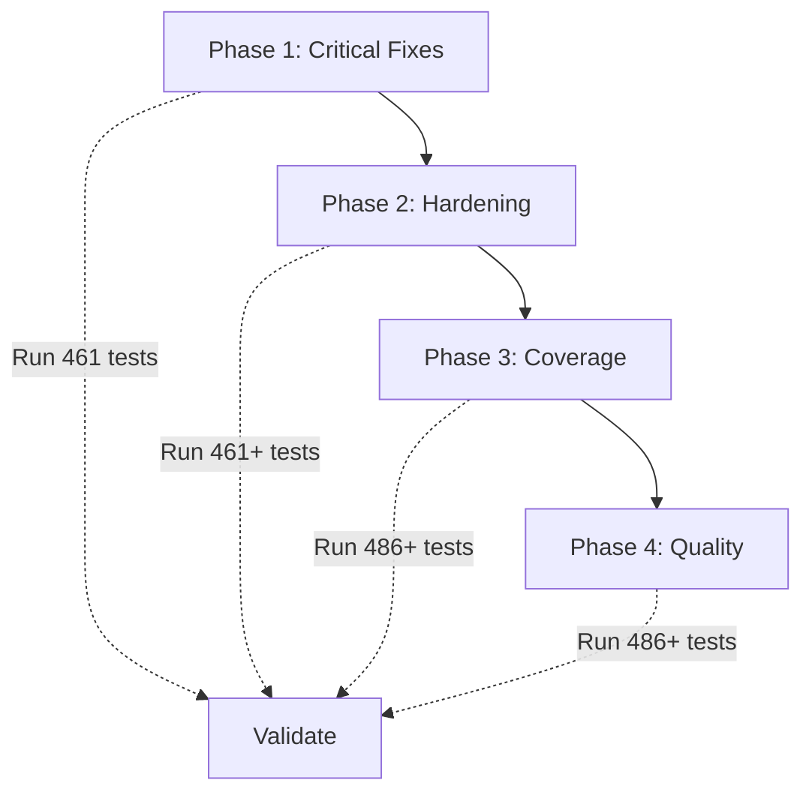

# Verity Core and Engine — Deep Audit and Enhancement Plan

> **Baseline**: 461/461 tests passing - 2.2s total - 57 test files
> **Audit Scope**: risk-engine.js, text-scanner.js, ai-meta-fusion.js, ai-nlp-classifier.js, secv-intent-engine.js, markov-lexical-scorer.js, verdict-contract.js, service_worker.js, scanner.js (mobile), sw.js (PWA)

---

## Audit Summary

| Severity | Count | Category |
|----------|-------|----------|
| CRITICAL | 5 | Security and correctness bugs that could cause bypass or false negatives |
| HIGH | 7 | Architectural flaws impacting robustness and maintainability |
| MEDIUM | 7 | Performance, coverage gaps, and edge-case mishandling |
| LOW | 4 | Code quality, DRY violations, and minor resilience gaps |

---

## CRITICAL FLAWS (P0)

### C1. else-if Override Priority Chain — Score Floor Masking
**File**: [risk-engine.js](file:///e:/verity/verity-extension/background/risk-engine.js#L984-L1094)

The entire hard-override score-floor block (lines 984-1094) uses a single `if / else if / else if` chain. **Only the FIRST matching condition applies its floor**, which means if `hasCrossOriginPasswordReuse` fires, later conditions like `hasBitbAttack` (score >= 95), `hasAitmReverseProxy` (score >= 95), or `hasClipboardAddressSwap` (score >= 95) are **silently masked**. In practice:

- A page with **both** `hasCrossOriginPasswordReuse` and `hasAitmReverseProxy` gets `max(score, 95)` — correct coincidentally.
- But a page with `hasAiNlpScamIntent` (floor 82) **and** `hasBitbAttack` (floor 95) gets floored to only **82**, not 95.
- A page with `hasSecvConvergence` (floor 85) **and** `hasClipboardAddressSwap` (floor 95) gets floored to only 85.

> [!CAUTION]
> Multi-vector attacks where the first-matching condition has a LOWER floor than a subsequent one will get under-scored. This is a **false-negative bypass vector**.

**Fix**: Replace the entire `else if` chain with independent `riskScore = Math.max(riskScore, N)` calls for each condition.

---

### C2. categories.scam Reference — Missing Object Property
**File**: [risk-engine.js](file:///e:/verity/verity-extension/background/risk-engine.js#L205-L206)

```javascript
categories.scam.flagged = true;        // line 205
categories.scam.reason = t(...);       // line 206
```

The `categories` object is defined with `scamFraud` (line 91), **not** `scam`. This writes to `undefined`, silently creating a new `categories.scam` property that nothing downstream reads. The Surveillance Extortion Trap signal **fails to flag the scamFraud category**.

---

### C3. categories.payment Reference — Missing Object Property
**File**: [risk-engine.js](file:///e:/verity/verity-extension/background/risk-engine.js#L213-L214)

```javascript
categories.payment.flagged = true;     // line 213
categories.payment.reason = t(...);    // line 214
```

Same issue — `categories` has no `payment` key. The NPCI Unsigned Collect signal silently writes to a phantom property.

---

### C4. Evidence Vault SHA-256 Fallback — Cryptographically Weak
**File**: [scanner.js](file:///e:/verity/mobile-scanner/scanner.js#L88-L98)

The `computeSha256` fallback (when `crypto.subtle` is unavailable) uses a custom 4x32-bit `Math.imul` hash that:
- Produces only 128 bits of entropy (4 x 32-bit state), **not** 256 bits as the function name promises.
- Is **not collision-resistant** — trivially collidable with ~2^64 attempts vs SHA-256's 2^128.
- Pads the output with zeros (`padEnd(64, '0')`) to fake a 256-bit hex string.

> [!CAUTION]
> On older devices without `crypto.subtle`, the immutable hash chain used for forensic evidence becomes trivially forgeable, undermining the entire evidence vault integrity guarantee.

---

### C5. Allowlist Unbreakable Invariant Bypasses Active Threats
**File**: [risk-engine.js](file:///e:/verity/verity-extension/background/risk-engine.js#L1200-L1225)

Lines 1200-1225 implement a "Step 3.2 Unbreakable Invariant" that returns `score: 0, allow, safe` for **all** allowlisted domains that lack `hasDangerousDownload` or `hasCredentialExfil`. But this check runs **AFTER** the full signal processing, meaning it can silently zero out legitimate detections like:
- `SIG_PHISHING_KIT_WEBHOOK_EXFIL` on a compromised allowlisted domain
- `SIG_CLICKFIX_CLIPBOARD_ATTACK` on a hijacked allowlisted page
- `SIG_BITB_FAKE_WINDOW_ATTACK` served from an XSS-injected allowlisted origin

The earlier allowlist cap (line 1151) already checks many of these conditions, making this second check both **redundant** and **dangerously broader** in scope.

---

## HIGH FLAWS (P1)

### H1. Monolithic calculateRisk() — 1250-Line God Function
**File**: [risk-engine.js](file:///e:/verity/verity-extension/background/risk-engine.js)

The entire risk scoring pipeline is a single 1250-line function with 80+ `has*` boolean flags, 3 separate scoring stages, inline signal emission, category flagging, and score capping. No clear phase separation or composability. The `else if` chain bug (C1) is a direct consequence of this monolithic structure.

### H2. Neural MLP Weights — Hardcoded Without Calibration Tracking
**File**: [ai-meta-fusion.js](file:///e:/verity/verity-extension/background/ai-meta-fusion.js#L116-L138)

The 2-layer MLP weights (`W1`, `B1`, `W2`, `B2`) are magic numbers with no calibration dataset documentation, training methodology reference, version tracking, or validation score baseline.

### H3. NLP Classifier Feature Weights — Static Dictionary, No Learning
**File**: [ai-nlp-classifier.js](file:///e:/verity/verity-extension/shared/ai-nlp-classifier.js#L34-L180)

The `FEATURE_WEIGHTS` dictionary maps ~150 hand-curated tokens to log-odds weights. Adversaries can trivially evade by using synonyms or neologisms not in the dictionary.

### H4. Diminishing Weights Array — Fixed 5-Element Cap
**File**: [risk-engine.js](file:///e:/verity/verity-extension/background/risk-engine.js#L735-L740)

Only 5 weights specified but system defines 8+ category types. Pages triggering 6+ categories effectively lose 90% of marginal signal value.

### H5. Service Worker PWA Cache — No Integrity Verification
**File**: [sw.js](file:///e:/verity/mobile-scanner/sw.js)

No SRI hash verification, no cache expiration, no runtime integrity checks. A compromised CDN during initial cache-fill could permanently poison the offline cache.

### H6. scanId Generation — Predictable, Non-Cryptographic
**File**: [verdict-contract.js](file:///e:/verity/verity-extension/shared/verdict-contract.js#L88-L92)

Uses `Math.random()` which is not cryptographically secure. Becomes critical if scan IDs are referenced in evidence receipts shared with law enforcement.

### H7. url and hostname Missing from Final Return Object
**File**: [risk-engine.js](file:///e:/verity/verity-extension/background/risk-engine.js#L1234-L1249)

The final return block doesn't include `url` or `hostname` fields, unlike the early-return trusted-domain block which includes both. Inconsistent verdict contract.

---

## MEDIUM FLAWS (P2)

### M1. Markov Scorer — No Non-Latin Alphabet Support
**File**: [markov-lexical-scorer.js](file:///e:/verity/verity-extension/shared/markov-lexical-scorer.js)

Only operates on ASCII a-z. DGA-generated domains using Cyrillic, Arabic, or CJK characters bypass detection entirely.

### M2. SECV Synergy Formula — Extraction Axis Zeroes Out Everything
**File**: [secv-intent-engine.js](file:///e:/verity/verity-extension/shared/secv-intent-engine.js#L16-L18)

When E = 0 (no extraction keywords), the entire synergy term collapses to 0, even if Authority, Catastrophic Loss, and Temporal Urgency are all maximally activated. Voice-call coercion scams get under-detected.

### M3. Content Script Size — 174KB Single File
**File**: [content-script.js](file:///e:/verity/verity-extension/content/content-script.js) (174,400 bytes)

A single 174KB content script injected into every page. ~50-100ms injection overhead on mobile.

### M4. No Rate Limiting on Evidence Vault Writes
**File**: [scanner.js](file:///e:/verity/mobile-scanner/scanner.js)

No maximum record count, no storage quota monitoring, no eviction policy. Could exhaust localStorage and break the hash chain.

### M5. Missing Input Sanitization in emitSignal
**File**: [risk-engine.js](file:///e:/verity/verity-extension/background/risk-engine.js#L95-L106)

Arbitrary `params` serialized into reason text without escaping. Potential XSS vector through `domSignals.digitalArrestPhrase` or similar fields.

### M6. isUrlShortener Import — Potentially Unused
**File**: [text-scanner.js](file:///e:/verity/verity-extension/shared/text-scanner.js#L23)

Imported but may not be used directly, adding unnecessary bundle size.

### M7. Redundant urlLower Variables
**File**: [risk-engine.js](file:///e:/verity/verity-extension/background/risk-engine.js)

Three identical `(url || '').toLowerCase()` computations at lines 118, 882, and 959.

---

## LOW FLAWS (P3)

### L1. Dead Ternary — Source Always 'url'
**File**: [risk-engine.js](file:///e:/verity/verity-extension/background/risk-engine.js#L112)

```javascript
const source = (sigId === 'RULE_IP_BASED_URL') ? 'url' : 'url';
```

### L2. SHA-256 Fallback Pad Character Bias
Zero-padding creates a distinguishable pattern identifying fallback-hashed entries.

### L3. No JSDoc or TypeScript Interfaces for Verdict Shape
No formal type definitions for the 15+ field verdict objects.

### L4. Magic Number Thresholds Scattered Through Engine
Values like 0.78, 0.82, 0.85, 30, 70, 35, 40, 65, 95 as bare numeric literals.

---

## IMPLEMENTATION PLAN

### Phase 1: Critical Security Fixes (P0) — Immediate
**Estimated Effort**: 2-3 hours | **Test Impact**: Must maintain 461/461

| # | Fix | Files | Risk |
|---|-----|-------|------|
| 1a | Replace else-if chain with independent Math.max calls | risk-engine.js | Low |
| 1b | Fix categories.scam to categories.scamFraud and categories.payment to categories.scamFraud | risk-engine.js | Low |
| 1c | Add condition checks to Unbreakable Invariant to respect active threats | risk-engine.js | Medium |
| 1d | Add url and hostname to the final return object | risk-engine.js | Low |
| 1e | Add comprehensive tests for multi-signal override stacking | New test file | None |

### Phase 2: Architectural Hardening (P1) — This Sprint
**Estimated Effort**: 4-6 hours

| # | Enhancement | Files | Risk |
|---|-------------|-------|------|
| 2a | Extract score-floor logic into applyScoreFloors module | risk-engine.js, new score-floors.js | Medium |
| 2b | Replace Math.random() scan ID with crypto.getRandomValues() | verdict-contract.js | Low |
| 2c | Add named constants for all magic thresholds | New engine-constants.js | Low |
| 2d | Strengthen SHA-256 fallback or reject insecure environments | scanner.js | Low |
| 2e | Add SRI hashes to service worker precache manifest | sw.js | Low |

### Phase 3: Coverage and Accuracy Improvements (P2) — Next Sprint
**Estimated Effort**: 6-8 hours

| # | Enhancement | Files | Risk |
|---|-------------|-------|------|
| 3a | Add non-Latin DGA detection to Markov scorer | markov-lexical-scorer.js | Low |
| 3b | Add SECV base score independent of Extraction axis | secv-intent-engine.js | Medium |
| 3c | Add localStorage quota monitoring and ring-buffer eviction | scanner.js | Low |
| 3d | Sanitize all params values through HTML-entity-escape | risk-engine.js | Low |
| 3e | Extend diminishing weights array to 9 entries | risk-engine.js | Low |

### Phase 4: Code Quality and Maintainability (P3) — Backlog
**Estimated Effort**: 3-4 hours

| # | Enhancement | Files | Risk |
|---|-------------|-------|------|
| 4a | Remove dead ternary on line 112 | risk-engine.js | None |
| 4b | Consolidate 3 redundant urlLower variables | risk-engine.js | None |
| 4c | Add JSDoc typedef for RiskVerdict and RawSignal shapes | risk-engine.js | None |
| 4d | Split content-script.js into modular detectors | content-script.js | High |

### Phase 5: Validation and Regression Guard — Continuous

| # | Task |
|---|------|
| 5a | Run full 461-test suite after each phase — zero regressions allowed |
| 5b | Add new tests for each fix (target: +25 tests minimum) |
| 5c | Add benchmark test asserting calculateRisk completes in less than 5ms |
| 5d | Create parity fixtures for multi-override stacking scenarios |

---



> **Ready to proceed?** Hit **Proceed** to begin Phase 1 execution (Critical Security Fixes).
