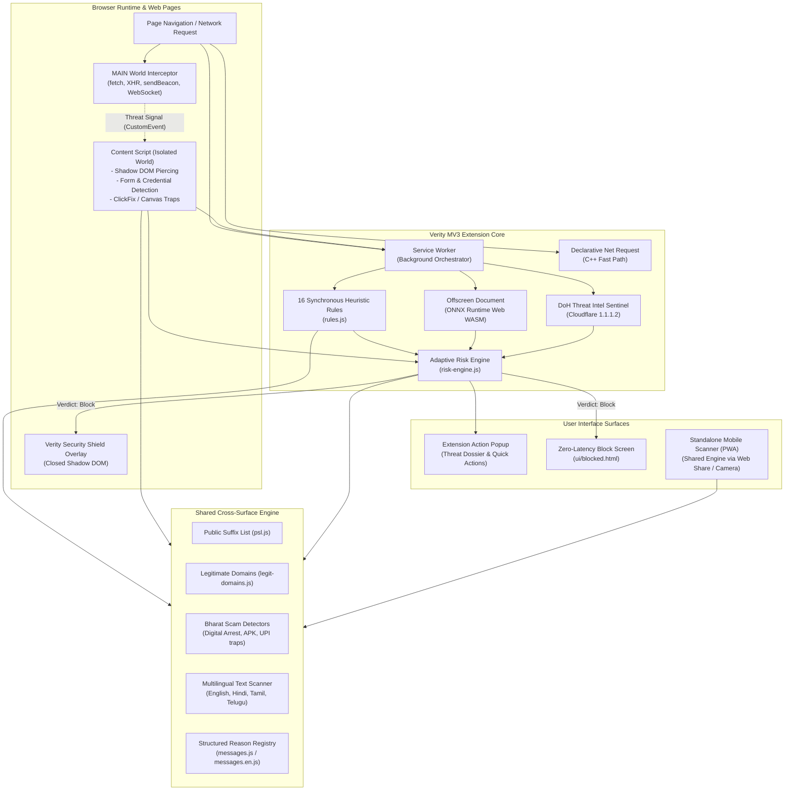

# Verity 2.0: Technical Architecture & System Design Specification

This document provides a comprehensive technical architecture and design reference for **Verity 2.0 (Bharat Shield)** — an on-device, real-time cyber defense platform engineered to neutralize phishing, brand impersonation, malvertising, financial fraud, and cyber scams before harm occurs.

---

## 1. System Architecture Diagram



---

## 2. Request Flow for a URL

When a user navigates to a URL or a link is opened in the browser:

```
[Navigation Initiated]
          │
          ▼
1. MAIN World Interception (`main-world-interceptor.js`)
   - Early exit if domain matches top trusted root domains regex.
   - Installs prototype traps on `fetch`, `XMLHttpRequest`, `navigator.sendBeacon`, and `WebSocket`.
   - Halts immediate malvertising rotator bridges (`window.stop()`).
          │
          ▼
2. Declarative Fast-Path Check (Declarative Net Request)
   - Chrome's native C++ network engine matches against dynamic rules synced from known malware feeds.
   - If matched, immediately redirects request to `ui/blocked.html` in 0.001ms.
          │
          ▼
3. Service Worker Background Orchestration (`service_worker.js`)
   - URL is normalized and domain parsed via Public Suffix List (`psl.js`).
   - Domain checked against `legit_domains.js` (Allowlist).
   - If trusted top infrastructure domain (e.g. `accounts.google.com`), fast-path ALLOW verdict returned.
          │
          ▼
4. Synchronous Heuristic Rules Execution (`rules.js`)
   - Evaluates 16 synchronous rules (IP hostname, missing HTTPS, excessive subdomains, brand in subdomain/path,
     Levenshtein typosquatting, DGA entropy, suspicious TLDs, malvertising rotator tokens, piracy keywords).
          │
          ▼
5. On-Device Machine Learning Evaluation (`ml-scorer.js` -> `offscreen.js`)
   - In the extension, URL is passed to the offscreen document running ONNX Runtime Web via WASM.
   - 18 lexical and structural features are extracted by `extractRichFeatures()`.
   - ONNX model outputs probability score [0.0 - 1.0], scaled into ML risk score [0 - 35].
          │
          ▼
6. Content Script DOM Inspection (`content-script.js`)
   - Injected at `document_start` into the page.
   - Pierces standard and open Shadow DOM trees to discover input fields, login forms, and payment fields.
   - Analyzes page text and links with `BharatScamDetectors` (Digital Arrest, fake APK droppers, UPI collect lures).
   - Checks for ClickFix command execution traps, Canvas-rendered credential forms, and favicon hash hotlinking.
          │
          ▼
7. Privacy-Preserving Threat Intelligence Sentinel (`reputation.js`)
   - If domain is not in the local allowlist, queries Cloudflare Security DoH (`1.1.1.2`) for domain sinkholing.
   - Transmits hostname only; zero paths, parameters, or user tokens are sent.
          │
          ▼
8. Adaptive Risk Engine Aggregation (`risk-engine.js`)
   - Censors raw points per category using documented `CATEGORY_CAPS`.
   - Sorts category scores descending and applies diminishing weights `[1.0, 0.75, 0.55, 0.35, 0.20, 0.10]`.
   - Evaluates pairwise synergy bonuses, hard cyber fraud overrides, and malvertising triggers.
   - Enforces the **Convergence Rule** (requiring independent multi-source corroboration for blocks).
          │
          ▼
9. Enforcement Action
   - **Safe (Score 0 - 34)**: Page proceeds untouched; safe green badge in action popup.
   - **Caution (Score 35 - 69)**: Advisory warning badge displayed in action popup.
   - **Danger (Score 70 - 100)**: Content script renders closed Shadow DOM security overlay, halts page loading (`window.stop()`), neutralizes timers and auto-redirects, offering user safe rollback or conscious override.
```

---

## 3. Risk Engine Mathematical Formulation

The Verity Risk Engine (`background/risk-engine.js`) maps multi-dimensional behavioral, lexical, and heuristic threat signals into a bounded risk score $S \in [0, 100]$.

### 3.1 Category Caps (`CATEGORY_CAPS`)
Signals are grouped into 11 functional threat categories. To enforce defense-in-depth and ensure no single heuristic category causes an accidental block on benign websites, each category is strictly bounded:

$$\text{cappedScore}(c) = \min\left(\sum_{s \in c} \text{score}(s), \text{CAP}(c)\right)$$

| Category ($c$) | Cap ($\text{CAP}$) | Description |
| :--- | :---: | :--- |
| `url` | 55 | URL structure, missing HTTPS, excessive subdomains, path depth |
| `ip_host` | 60 | Raw IPv4/IPv6 hostnames and direct IP access |
| `malvertising` | 85 | Pop-under networks, rotator tokens, hex search payloads |
| `brand_impersonation` | 65 | Brand names in unauthorized domains, Levenshtein typosquatting |
| `ml` | 45 | On-device ONNX machine learning probability score |
| `dom_credentials` | 60 | Unverified password inputs, credential collection forms |
| `scam_language` | 75 | High-pressure urgency phrases, fake verification lures |
| `payment_phishing` | 68 | Unverified credit card, CVV, OTP, or payment provider forms |
| `synergy` | 40 | Pairwise cross-category correlation bonuses |
| `download` | 60 | Dangerous file extensions, disguised double-extensions |
| `threat_intel` | 65 | Cloudflare 1.1.1.2 DNS sinkhole intelligence |

**Invariant:** Notice that standard heuristic categories (`url: 55`, `brand_impersonation: 65`, `dom_credentials: 60`, `download: 60`) have caps strictly below the block threshold (70). Multi-category convergence is required to reach a Block.

### 3.2 Asymptotic Diminishing Marginal Risk
Raw linear addition causes rapid saturation at 100 for websites triggering multiple minor warnings. Verity sorts all active non-zero category scores in descending order:

$$\text{sortedScores} = \text{sort\_desc}(\{\text{cappedScore}(c) \mid \text{cappedScore}(c) > 0\})$$

Weights are applied monotonically:

$$W = [1.0, 0.75, 0.55, 0.35, 0.20, 0.10, \dots]$$

The composite base risk score is computed as:

$$\text{baseScore} = \sum_{i=0}^{N-1} \text{round}\left(\text{sortedScores}[i] \times W[i]\right)$$

The highest-severity category provides full weight ($100\%$), while subsequent secondary categories add diminishing marginal risk ($75\% \to 55\% \to 35\% \to 20\% \to 10\%$).

### 3.3 Convergence Rule
A block-level verdict ($\text{score} \ge 70$, `action: 'block'`) **strictly requires independent evidence from at least two distinct operational sources**:
$$\text{Sources} \subseteq \{\text{'url'}, \text{'ml'}, \text{'dom\_credentials'}, \text{'download'}, \text{'threat\_intel'}\}$$

If a page reaches $\ge 70$ from only a single source without an authorized hard override:
- The verdict is **demoted to Caution ($\text{score} = 65$)**.
- This completely prevents isolated rule false positives (such as an unusual URL parameter on an enterprise portal) from breaking user workflows.

### 3.4 Hard Cyber-Fraud & Malvertising Overrides
High-confidence critical threats that represent unambiguous malicious intent bypass single-source demotion via explicit overrides:
- **`SIG_ILLEGAL_WEB_PIN_COLLECTION`** (Score $\ge 95$): In-browser collection of 4/6-digit UPI PINs or ATM PINs.
- **`SIG_PHISHING_KIT_WEBHOOK_EXFIL`** (Score $\ge 95$): Exfiltration to Telegram/Discord bot endpoints.
- **`SIG_BITB_FAKE_WINDOW_ATTACK`** (Score $\ge 95$): Browser-in-the-Browser simulated login popups.
- **`SIG_AITM_REVERSE_PROXY_PHISH`** (Score $\ge 95$): Adversary-in-the-Middle reverse proxy interception.
- **`SIG_CLICKFIX_CLIPBOARD_ATTACK`** (Score $\ge 85$): PowerShell/Run-box clipboard injection lures.
- **`SIG_MALICIOUS_APK_DROPPER`** (Score $\ge 90$): Fake utility/RTO Android package droppers.
- **`SIG_DIGITAL_ARREST_EXTORTION`** (Score $\ge 85$): CBI/Police arrest extortion notices.

### 3.5 Enterprise & Federated SSO Exemptions
Verified identity providers (`login.microsoftonline.com`, `accounts.google.com`, `company.okta.com`, `auth0.com`, `appleid.apple.com`):
- Mask URL keyword penalties (`login`, `oauth2`, `token`).
- Scale down ML weight ($\le 0.15$) to prevent long cryptographic OAuth token strings from triggering false lexical alarms.
- Known legitimate domains in `legit_domains.js` are capped at Caution ($\le 40$) unless an active credential-theft or malicious download signal is present.

---

## 4. The 18-Feature On-Device ONNX Machine Learning Model

### 4.1 Production Model (`phishing_model_v2.onnx`)
Verity ships an on-device LightGBM model converted to ONNX format, executed client-side via ONNX Runtime Web WASM in an offscreen document (`background/offscreen.js`).

### 4.2 Feature Vector Definition (18 Features)
Extracted by `extractRichFeatures(urlString)` in `background/rich-feature-extractor.js`:

1. `url_length`: Total character length of the URL.
2. `hostname_length`: Length of the hostname component.
3. `path_length`: Length of the URL path.
4. `subdomain_count`: Number of subdomain segments separated by dots.
5. `is_ip_address`: Binary flag ($1.0$ if hostname is IPv4/IPv6, else $0.0$).
6. `has_punycode`: Binary flag ($1.0$ if `xn--` prefix is present, else $0.0$).
7. `entropy`: Shannon entropy calculation of hostname character distribution ($-\sum p_i \log_2 p_i$).
8. `hyphen_count`: Number of hyphens in hostname.
9. `numeric_ratio`: Proportion of numeric digits in hostname ($[0.0 - 1.0]$).
10. `suspicious_tld`: Binary flag ($1.0$ if TLD belongs to high-abuse list like `.xyz`, `.top`, `.monster`, `.click`).
11. `query_length`: Character length of the search query string.
12. `vowel_consonant_ratio`: Ratio of vowels to consonants in the root domain label.
13. `brand_min_dist`: Normalized minimum Levenshtein distance against protected brand catalog.
14. `has_mixed_script`: Binary flag ($1.0$ if mixed Cyrillic/Greek/Latin scripts detected).
15. `sensitive_dir_depth`: Count of sensitive keywords (`login`, `auth`, `wp-content`, `plugins`, `verify`) in path segments.
16. `longest_token_length`: Length of the longest unbroken alphanumeric token in URL path/query.
17. `special_char_density`: Ratio of special characters (`@`, `_`, `=`, `%`, `&`, `?`) to total URL length.
18. `is_port_in_url`: Binary flag ($1.0$ if non-standard port like `:8080`, `:8443`, `:8888` is present).

### 4.3 Training Dataset & Defensible Evaluation
- **Dataset Size**: **4,750 URLs** split strictly by `registeredDomain` to prevent data leakage between subdomains:
  - Tranco Top 1M (ranks 1–1,000 and 1,000–100,000): 2,000 URLs
  - Curated Hard Cases (Gov/Banking/Shortener/Tracking): 50 URLs
  - Phishing.Database Active Feed: 1,000 URLs
  - OpenPhish Community Feed: 500 URLs
  - URLhaus Recent High-Confidence Malware Feed: 1,200 URLs
- **Validation Methodology**: 5-Fold GroupKFold cross-validation grouped by `registeredDomain` across 2,338 development URLs.
- **Model Metrics (from `training/model_metrics.json`)**:

| Configuration | Threshold | Accuracy | Precision | Recall | F1 Score | Benign FPR |
| :--- | :---: | :---: | :---: | :---: | :---: | :---: |
| **With HTTP & IP Features** | **35 (Caution)** | 98.72% ± 0.84% | 97.43% ± 1.76% | 100.00% ± 0.00% | 98.69% ± 0.90% | 2.15% ± 1.49% |
| **With HTTP & IP Features** | **70 (Danger)** | **98.97% ± 0.72%** | **99.30% ± 0.74%** | **97.91% ± 1.45%** | **98.59% ± 1.01%** | **0.58% ± 0.61%** |
| **Without HTTP & IP Features** | 35 (Caution) | 98.46% ± 1.03% | 97.35% ± 1.87% | 99.66% ± 0.53% | 98.48% ± 1.03% | 2.24% ± 1.60% |
| **Without HTTP & IP Features** | 70 (Danger) | 98.76% ± 0.81% | 99.41% ± 0.62% | 97.38% ± 1.94% | 98.37% ± 1.15% | 0.49% ± 0.48% |

### 4.4 Clarification on `extract26Features` vs Active Runtime Model
In `background/rich-feature-extractor.js`, `extract26Features()` combines the 18 baseline lexical features with 8 advanced structural features (`vowelConsonantRatio`, `brandMinDist`, `hasMixedScript`, `numSubdomains`, `sensitiveDirDepth`, `longestToken`, `specialCharDensity`, `isPortInUrl`). 
- **Current Runtime Status**: The active production model `background/model/phishing_model_v2.onnx` executed in `offscreen.js` uses **`extractRichFeatures` (18 features)**.
- `extract26Features` was introduced as a candidate pipeline for the quantized v3 experimental model (`phishing_model_v3.onnx`) and is verified in unit tests (`tests/nextgen_threat_matrix.test.js`), but is not currently wired into the primary production `offscreen.js` inference loop.

---

## 5. Bharat Shield: Targeted Cyber Fraud Detectors

Designed specifically to protect Indian citizens, elderly users, and non-technical demographics against localized fraud vectors:

### 5.1 "Digital Arrest" & Police Extortion Defense
- **Threat**: Scammers impersonating the Central Bureau of Investigation (CBI), Enforcement Directorate (ED), Narcotics Control Bureau (NCB), Mumbai/Delhi Police, or TRAI claiming an Aadhaar card was linked to illegal parcels or money laundering, demanding victims stay on video call ("digital arrest") and transfer money.
- **Engine**: Multilingual text regex in [content/bharat-scam-detectors.js](file:///e:/Finebehaviour%20-%20Copy%20-%20Copy%20%282%29/verity-extension/content/bharat-scam-detectors.js) supporting English, Hindi (सीबीआई, डिजिटल अरेस्ट, मनी लॉन्ड्रिंग), Tamil (சிபிஐ), and Telugu.
- **Action**: Emits `SIG_DIGITAL_ARREST_EXTORTION` (Score 85 instant block) with citizen warning instructions.

### 5.2 Malicious APK Dropper Detection
- **Threat**: Phishing landing pages that distribute deceptive Android `.apk` dropper files disguised as:
  - Traffic Challan / e-Challan updates (`RTO_Challan.apk`, `Parivahan_Sewa.apk`)
  - Government welfare schemes (`PM_Kisan_Yojana.apk`, `Ladli_Behna.apk`)
  - Utility bill arrears (`Electricity_Bill_Update.apk`)
  - Wedding invitations (`Wedding_Card.apk`)
- **Action**: Analyzes links and filenames for APK patterns combined with scam lures; emits `SIG_MALICIOUS_APK_DROPPER` (Score 90 block).

### 5.3 Deceptive UPI Collect & QR "Quishing" Traps
- **Threat**: Fraudulent links or QR codes claiming to give cashback, lottery winnings, or OLX buyer deposits that actually initiate a `upi://pay` **debit** transaction with an embedded payment amount (`am=`) and payee VPA (`pa=`).
- **Engine**: Parses deep-links and image payloads to verify transaction semantics. Flags requests where citizens are lured to "receive money" by authorizing a debit request.
- **Action**: Emits `SIG_UPI_QR_COLLECT_TRAP` (Score 85 block).

### 5.4 Illegal In-Browser UPI PIN Interception
- **Threat**: Phishing websites displaying web forms requesting a user's 4-digit or 6-digit UPI PIN or ATM PIN.
- **Invariant**: The official NPCI UPI architecture **strictly prohibits** entering UPI PINs in web browsers (UPI PINs may only be entered on certified Android/iOS NPCI MPIN keyboards).
- **Action**: Any web page requesting an in-browser UPI PIN triggers `SIG_ILLEGAL_WEB_PIN_COLLECTION` (Score 95 critical block).

---

## 6. Privacy & DPDP Compliance

Verity was architected around **privacy by design** and aligns with India's **Digital Personal Data Protection (DPDP) Act 2023**:

1. **Zero Browsing Telemetry**: No browsing history, URLs, search queries, cookies, or user identifiers are collected, transmitted, or stored on remote servers.
2. **Strictly On-Device Processing**: URL parsing, feature extraction, heuristic rule evaluation, DOM inspection, and ML inference execute entirely within the local browser environment.
3. **DNS-over-HTTPS Privacy Sentinel**: Only unfamiliar hostnames (not in the local allowlist) are queried against Cloudflare/Quad9 via DoH. No paths, parameters, form data, or IP addresses are sent.
4. **Threat Feed Synchronization**: Threat intelligence sync is a one-way, read-only download of known malicious domain hashes. No client device metadata is reported during sync.
5. **No Credential Logging**: DOM inspection checks only for field presence and structural attributes; user keystrokes and submitted inputs are never inspected or retained.

---

## 7. Known Architectural Limitations

For an honest, transparent breakdown of platform edge cases (including Web Worker bypasses, dynamic eval construction, canvas form limitations, PWA sandboxing, and DoH granularity), see:
👉 [KNOWN_LIMITATIONS.md](file:///e:/Finebehaviour%20-%20Copy%20-%20Copy%20%282%29/docs/KNOWN_LIMITATIONS.md)
